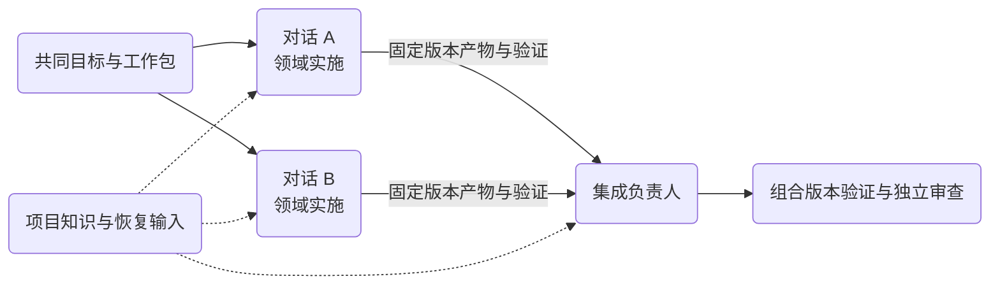

# longtask

**让 Codex 长任务持续推进，跨会话恢复，并完成可核验的交付。**

[](https://github.com/J-ChenX/longtask/actions/workflows/ci.yml)
[](LICENSE)
[](https://www.python.org/downloads/)
[](https://agentskills.io/specification)

longtask 是面向 Codex 的长任务编排与会话连续性增强插件。它通过分层记忆、多对话协作和压缩前窗口传递支持长任务：保存目标、设计与执行断点，组织多个对话分工，在授权与宿主能力范围内提前交给新窗口，再对照当前版本的证据核验整体结果。

[主要功能](#主要功能) · [压缩前窗口传递](#压缩前窗口传递) · [记忆系统](#记忆系统) · [多对话协作系统](#多对话协作系统) · [快速开始](#快速开始) · [文档导航](#文档导航)

## 主要功能

| 你要解决的问题 | longtask 怎么帮助你 | 可以得到什么 |
|---|---|---|
| **长期工作中需要保留背景和决策** | [记忆系统](#记忆系统)分层保存项目知识、任务断点和验证依据，按当前问题检索 | 有来源、可定位、可核对版本的恢复输入 |
| **上下文接近压缩，任务还没做完** | [压缩前窗口传递](#压缩前窗口传递)在安全出口保存必要信息、停止旧写入者，并建立和确认新窗口接管 | 在新窗口继续原目标，保留未提交成果与原对话定位 |
| **任务很大，需要逐步完成** | 明确目标和验收，组织有依赖的工作包，按当前缺口持续推进 | 可执行的任务范围、分段成果和剩余验收 |
| **换会话后，需要接着做** | 保存唯一临时检查点；新会话核对合同、源码和证据，按需回查原对话 | 当前进展、未完成项、必要输入和下一具体动作 |
| **多个部分需要分工和集成** | [多对话协作系统](#多对话协作系统)在授权和宿主能力范围内组织独立对话，划分写集、工作树、责任和接线边界 | 各区域可独立验收的结果，以及集成后的验证 |
| **项目中途改变需求或设计** | 协调受影响合同、工作包和证据，维护当前架构与决策依据 | 一致的当前设计，以及明确需要重新验证的范围 |
| **需要知道任务是否真正完成** | 将测试与独立审查绑定到当前产物，逐项检查验收并整理项目知识 | 有适用范围的验证结论；满足完成条件后清除临时状态 |

例如，“接手一个已有系统，调整审批规则并完成附件上传”可以先补齐可靠依据，再修改相关合同、分包实施、验证和审查；切换会话后继续处理尚未满足的验收。最终留下代码和当前项目知识，调查与试错过程保留在原对话。

## 压缩前窗口传递

**让未完成工作在压缩前交给全新窗口，是 longtask 的核心接续能力。** 启用自动接续且宿主能力可用时，当前对话会根据工作片段、材料负担和可信用量预警选择安全出口，预留整理和交接的余量。用户选择避免压缩时，提前接管与独立禁压缩门配合使用。


传递的内容包括原目标、核心成果及版本定位、剩余验收、未提交改动、失败或未运行的检查、必要授权来源和原对话定位。已有 longtask 任务沿用唯一检查点；常规任务采用轻量交接。详细调查过程留在原对话，新窗口需要时再定向回查。

| 接续路径 | 什么时候发生 | 启用与作用 |
|---|---|---|
| **压缩前主动接管** | 当前模型仍可执行，在安全片段出口或有效提前预警后移交 | 需要相应的创建/消息授权和可用会话工具；新窗口核对基线并开始下一动作后才确认接管 |
| **压缩前备用派发** | 已显式启用的 POSIX 备用链在压缩前同步回调中执行 | 须能核验对应 daemon、来源与遗留写入者；否决压缩并尝试派发，接收者核验旧轮终态后才继续 |
| **压缩后恢复导航** | 压缩已经发生，默认随包的信号桥提供恢复指引 | 钩子须经宿主审阅信任；引导核对状态和选择接续出口，允许发生压缩 |

提前接管需要在模型仍可执行时开始；同步禁压缩门负责拒绝压缩，创建回执只证明派发。缺少提前事件、原生工具、受信钩子或接管确认时，保留恢复输入并明确报告缺口，不能承诺所有任务零压缩。

任务内的交接策略见[提前交接与禁压缩](references/任务推进.md#提前交接与禁压缩)；让常规任务也获得提前提示的可选宿主配置见[全局接续](references/全局接续.md)。

## 记忆系统

记忆系统让后续对话能够找回“为什么这样做、做到哪里、哪些结论仍然有效”。信息保存在项目文件、临时检查点、版本证据和可回查的原对话中，各有明确用途：

| 记住什么 | 保存在哪里 | 后续怎样使用 |
|---|---|---|
| **项目目标、架构与决策** | 项目总览、模块文档和必要的专项章节（L0/L1/L2），以及决策文档 | 长期维护当前设计与约束；新对话先定位目标，再按职责读取相关内容 |
| **未完成工作的执行断点** | 每个工作区唯一的 `.longtask/state.json` | 恢复工作包、依赖、验收、阻塞项和下一动作；完成后清除临时状态 |
| **验证结论及适用版本** | 与 Git/产物摘要绑定的测试、审查和批准证据 | 判断结论检查了哪些内容，变更后识别需要重新验证的范围 |
| **调查、试错与讨论过程** | 可访问的原对话及其宿主/聊天定位 | 缺少细节时围绕具体问题回查，恢复消息只传核心结果和必要定位 |

恢复时先取得有界任务视图，再按问题读取相关章节、源码符号和必要输入；知识索引支持按路径、标题和正文线索定位，读取结果保留来源、摘要及省略信息。它让对话消费当前需要的材料，并核对材料是否仍适用。已有结论与当前合同、源码或环境冲突时，协调或重验后再继续。

任务收尾时，长期有效的规则和理由合并到当前项目知识，临时执行状态清除。保存、检索与新鲜度的具体合同见[文档架构](文档架构.md)、[知识检索接口](docs/modules/文档架构.md#知识检索接口)和[状态协议](references/状态协议.md)。

## 多对话协作系统

多对话协作让同一目标由多个独立对话共同推进。每个对话有明确的工作范围、输入、产物、验收和停止条件，通过固定版本的合同与成果衔接；集成负责人持续核对总目标，接入已到位的结果。

| 协作方式 | 适用情况 | 怎样衔接 |
|---|---|---|
| **按领域并行** | 接口、界面等工作可以隔离实施 | 为各对话划分写集和工作树，共享资源指定唯一负责人；各区域交付可消费的版本化产物 |
| **按依赖交付** | 后一个工作包需要前一个的接口或成果 | 提供方明确合同、版本和限制；消费方核对后适配、接线并验证，依赖就绪时推进集成 |
| **跨会话递进** | 当前对话需要在安全出口交给新对话 | 保存核心结果与断点，停止旧写入者；确认接收者核对基线并开始下一动作后移交 |



协作需要相应的创建/消息授权及宿主工具；并发写入采用隔离工作树，每个工作区保留自己的唯一检查点。各对话按需读取共享项目知识和必要的历史定位，交付结果分别核验。区域实现通过、消费者集成通过和整体目标完成分别判断，最终按组合版本的验收与独立审查收尾。

创建与派发、依赖消费、接线及恢复边界见[平行任务协作](references/平行任务协作.md)；自动接续的实际接管条件见[会话出口](references/任务推进.md#实际接管与当前会话出口)。

## 选择使用方式

| 你的需求 | 使用入口 | 启用条件 |
|---|---|---|
| **编排一个复杂编码任务** | 在任务中使用 `$longtask`，从规划、接入、续接、变更或审查开始 | 安装完整插件；跨会话、独立验收包或需保留决策时适用，小改动、解释和普通审查不自动进入完整流程 |
| **让常规任务也能提前换会话接续** | 显式配置[全局接续](references/全局接续.md)，采用轻量交接；已有 longtask 任务继续消费原检查点 | 用户明确选择、所需创建/消息授权、宿主原生会话工具，以及实际受信的钩子；安装插件不会自动启用 |

压缩前主动接管、POSIX 备用派发和默认随包的压缩后恢复桥分别见[窗口传递](#压缩前窗口传递)。配置、审阅信任与平台边界统一见[宿主集成](references/平台适配器.md#内置压缩信号桥)和[全局接续](references/全局接续.md)；安装插件不会自动登记可选全局能力。

## 快速开始

需要 **Codex 和 Python 3.14+**；Git 可提供版本证据和工作树隔离。

### 1. 获取并验证插件

```bash
git clone https://github.com/J-ChenX/longtask.git
cd longtask
python3 scripts/build_release.py build --root . --output dist/longtask-4.6.2.zip
python3 scripts/build_release.py verify --root . --archive dist/longtask-4.6.2.zip
```

构建与验证确认归档和源码一致。安装及发布还需相应验收；其他渠道的归档须核对受信 SHA-256。

### 2. 安装完整插件

按[安装指南](references/发布与恢复.md#个人-codex-安装)配置完整插件目录和个人 marketplace，再执行：

```bash
codex plugin add longtask@personal
```

启动新会话，确认插件只提供 `$longtask` 一个入口。解释器绑定、旧同名技能及缓存处理均见安装指南。缺少宿主会话工具时，可显式登记[可选会话 MCP 入口](references/平台适配器.md#可选-codex-会话-mcp-入口)。

### 3. 提出目标

```text
用 $longtask 推进这个需要多次会话完成的编码任务，明确验收并保存恢复信息。
```

只规划、只查看或只审查时直接说明。希望自动接续或多窗口实施，可给出对应授权：

```text
用 $longtask 将本任务拆成可独立验收的工作包，按需要建立多个独立对话实施并协调集成。
授权在本任务范围内创建接续对话，并传递必要的分工、结果和续接消息。
在安全出口停止旧写入者，确认新会话核对基线并开始下一动作后交接；需要细节时回查原对话。
```

实际执行仍需核对宿主能力与隔离条件，详见[分段交付与会话出口](references/任务推进.md#会话预算与递进交接)。

## 模式与场景

公开入口只有 [`$longtask`](SKILL.md)，五种模式按需加载，用户无需记忆模式名称：

| 模式 | 用途与示例 |
|---|---|
| [setup](references/新建项目.md) | 从零建立目标、设计与验收：“规划一个报销系统，先不实施。” |
| [retrofit](references/既有项目接入.md) | 为缺少可靠依据的已有实现补齐理解：“接手这个系统，厘清行为和意图后继续。” |
| [continue](references/任务续接.md) | 沿既有合同实现、修复、验证或维护：“审批规则已确定，继续完成附件上传。” |
| [modify](references/架构变更.md) | 改变既有规则、接口或职责：“单级审批改为按金额分级审批。” |
| [review](references/任务审查.md) | 对照批准合同核验指定成果：“只读审查审批规则、权限和验收证据。” |

模式可以随任务切换。触发、恢复与授权的执行合同统一见[根技能](SKILL.md#模式参考)。

## 工作原理

Skill 根据当前目标选择工作流。记忆系统提供有来源的项目知识和恢复输入，多对话协作组织工作包、成果交付与会话移交，状态运行时校验依赖、写集和证据新鲜度。满足验收与独立审查条件后，合并当前项目知识并清除临时状态。

批准目标与合同定义预期行为；代码、测试和运行结果提供已观察证据。检查点不授予权限，文档齐全和局部通过不能代替整体完成。恢复与资料查询见[操作示例](references/操作示例.md)。

## 兼容性与验证边界

**仅支持 Codex 的个人使用。** 同一大版本的有效检查点支持次版本与补丁升级后恢复；跨大版本拒绝，完整规则见[兼容性策略](references/发布与恢复.md#兼容性策略)。插件故障用同版本受信工件完整重装。

在仓库根执行：

```bash
python3 scripts/validate_longtask.py
python3 -m unittest discover -s tests -v
python3 scripts/run_skill_evals.py
python3 scripts/run_forward_evals.py --run
```

源码检查不要求保留运行结果。显式核验本地证据用 `--with-evaluation-results`，提取工件自检用 `--installed`；正式发布须通过 `--require-release-pass`。候选自动发布及真实宿主证据边界见[发布合同](references/发布与恢复.md)，运行结果的归属见[项目规范](AGENTS.md#源码与产物架构规范)。

## 4.6.2 更新

正式交付原生提前通知，修复 Windows 短路径与私有 ACL 检查，改进工作包分工和大检查点恢复，并补齐恢复命令的 Codex 路径传递。变化、升级动作和验证范围见[版本说明](版本说明.md#462)。

## 文档导航

| 需要了解 | 阅读 |
|---|---|
| 架构、模块和设计依据 | [架构入口](docs/ARCHITECTURE.md) |
| Skill 格式与仓库维护 | [仓库维护](docs/仓库维护.md) |
| 状态、检查点、授权与完成 | [状态协议](references/状态协议.md) |
| 持久知识与文件命名 | [文档架构](文档架构.md) |
| 独立审查与发现关闭 | [专家审查协议](专家审查协议.md) |
| 多窗口协作与集成 | [平行任务协作](references/平行任务协作.md) |
| 评测方法与证据边界 | [评测协议](references/评测协议.md) |
| 安装、发布与兼容恢复 | [发布与恢复](references/发布与恢复.md) |
| 可选全局接续与平台限制 | [全局接续](references/全局接续.md) |

## 参与贡献

请先阅读[贡献指南](https://github.com/J-ChenX/longtask/blob/main/.github/CONTRIBUTING.md)，再提交可复现的 [Issue](https://github.com/J-ChenX/longtask/issues/new/choose) 或聚焦的 Pull Request。安全问题按[安全政策](https://github.com/J-ChenX/longtask/blob/main/.github/SECURITY.md)私下报告。

项目采用 [MIT 许可证](LICENSE)；格式遵循 [Agent Skills 规范](https://agentskills.io/specification)，发现与分发参照 [Codex 官方文档](https://developers.openai.com/codex/skills)。
