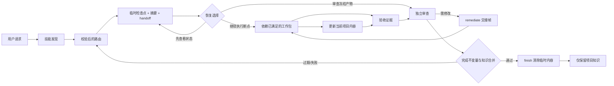

# 任务编排

**最后更新：** 2026-10-20

## 职责

路由大型任务、维护授权和事实边界、让阶段适应证据，并阻止未经证明的完成。

## 核心流程

| 阶段 | 必要结果 | 权威来源 |
|---|---|---|
| 路由 | 根据明确意图、已校验工作区状态和新鲜 handoff 建议入口；沿用会话有效授权，动作依据不足时询问恢复选择 | [SKILL.md](../../SKILL.md)、`longtask_state.py route` |
| 发现 | 目标、非目标、验收、约束、风险、来源 | 项目架构中的目标与约束、临时检查点 |
| 架构 | 边界、合同、决策、回滚、工作包 DAG | `docs/ARCHITECTURE.md`、模块/决策文档 |
| 执行 | 带工作包验收证据的集成改动 | 代码、Git/摘要、临时检查点 |
| 审查 | 绑定当前产物的独立风险覆盖 | 临时检查点的结构化 review 证据 |
| 完成 | 项目知识已合并、完成不变量已验证、临时内容已清除 | `knowledge` 证据与 `finish` |

所需证据已存在时可以合并阶段工作；阶段名称永远不能替代其证据。

## 合同导航

面向使用者的简介与执行指令分开维护，文档职责见[说明文档分工](../仓库维护.md#说明文档分工)。入口展示只概括用途，不增加执行权限或第二份流程。

根技能只维护入口、必要不变量和完成边界；主线/分支、分段及会话细节仅在对应决策时加载[任务推进](../../references/任务推进.md)。普通恢复按[续接消费合同](../../references/任务续接.md#恢复决策)消费 `context` 的只读视图；模式明确且无恢复需求时直接加载所选模式参考。资料/查询/检查的复用与刷新条件统一见[按需消费与验证](../../references/任务推进.md#按需消费与验证)，不把工具查询当作入口仪式。

共享事实与授权边界见[根技能](../../SKILL.md)，状态、交接及工作包规则见[状态协议](../../references/状态协议.md)，独立审查与发现关闭见[专家审查协议](../../专家审查协议.md)。模块文档不重复维护这些规则。

已有任务的 L4 变更由 `longtask_state.py modify` 转入架构阶段，保留原目标和不受影响的工作包；不能通过新建任务或改写 goal 代替该流程。

单一公开入口下的五种模式由[根技能的模式导航](../../SKILL.md#模式参考)维护。验证边界统一见[评测协议](../../references/评测协议.md)。

## 数据流

`modify` 命令在原任务记录架构变更，冻结受影响工作包及传递消费者并使证据失效；只有证明输入和写集彼此独立时，不受影响的工作包才能继续。

实际命令与故障恢复见[操作示例](../../references/操作示例.md)。

## 初始化保存边界

| 当前决策 | 权威入口 |
|---|---|
| 新项目设计、首次检查点及规划出口 | [初始化与交接](../../references/初始化与交接.md)、[新项目输出合同](../../文档架构.md#新项目输出合同) |
| 主线、分支、分段与发现保存 | [任务推进](../../references/任务推进.md) |
| 会话预算、禁压缩、历史回查及实际接管 | [会话策略](../../references/任务推进.md#会话预算与递进交接) |

`planning_checkpoint.py` 通过既有 CLI 保存 planned 包与交接，复用任务身份、CAS 和版本校验；它不建立第二状态或实施授权。状态工具负责恢复帧绑定，宿主能力及信号送达见[平台适配器](../../references/平台适配器.md)。

## 独立窗口

执行方式比较、写集隔离、外部合同消费、接线及重评见[平行任务协作](../../references/平行任务协作.md)。`codex_sessions.py` 提供显式会话适配，`session_permissions.py` 读取绑定来源的有界权限记录；能力、启用及未知结果边界由[可选适配合同](../../references/平台适配器.md#可选-codex-会话-mcp-入口)定义。

`tests/test_codex_sessions.py` 和 `tests/test_session_permissions.py` 验证适配器合同；合成结果不证明桌面派发、模型消费或真实接管，后者由[行为评测](../../references/评测协议.md)单独验证。

## 全局提前通知

`native_notice.py` 为 Windows/POSIX 提供显式启用的只读提前提示，`precompact_handoff.py` 复用它并保留 POSIX 私有回执与备用传输。两者共用 `session_permissions.py` 的有界快照读取器；用量读取不要求完整访问权限，也不输出或转移权限。安装、失败与实机覆盖边界只由[全局接续合同](../../references/全局接续.md)维护，测试由 `tests/test_native_notice.py` 和既有适配器测试消费。
